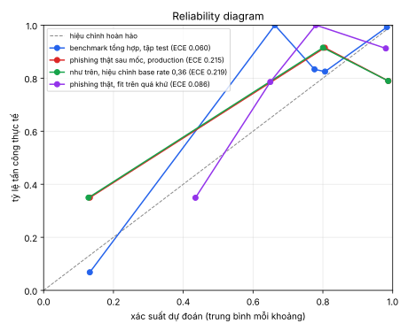

# Đánh giá thực tế

Sinh tự động bởi `benchmark/real_world.py`. Dữ liệu thô không nằm trong repo (điều khoản OpenPhish: chỉ dùng phi thương mại); script tải lại từ đúng commit đã ghim:

- phishing: OpenPhish Community Feed, lịch sử git `https://github.com/openphish/public_feed` tại `cd3df159544e`
- hợp lệ: Chrome UX Report top 1 triệu origin, `zakird/crux-top-lists` tại `35ba243941de`

271.231 host phishing khác nhau, xuất hiện từ 2024-10-12 đến 2026-11-03; 998.337 host hợp lệ.

## 1. Phishing thật: phạm vi và tỷ lệ phát hiện

**Phạm vi** (quy tắc minh bạch, không dùng engine): host có chứa từ khóa của một thương hiệu được bảo vệ sau khi bỏ dấu chấm / gạch, hoặc host dùng IDN (`xn--` / Unicode).

| | số host | tỷ lệ |
|---|---|---|
| toàn bộ phishing | 271.231 | 100% |
| trong phạm vi: nhắc thương hiệu được bảo vệ | 9.211 | 3,4% |
| trong phạm vi: IDN | 166 | 0,1% |
| ngoài phạm vi | 261.854 | 96,5% |

Tỷ lệ gắn cờ (SUSPICIOUS trở lên) theo profile:

| tập | default | banking | browser |
|---|---|---|---|
| toàn bộ (mẫu ngẫu nhiên) | 3,4% (1.025/30.000) | 3,4% (1.025/30.000) | 0,2% (49/30.000) |
| trong phạm vi: thương hiệu | 99,6% (9.176/9.211) | 99,6% (9.176/9.211) | 0,8% (72/9.211) |
| trong phạm vi: IDN | 9,0% (15/166) | 9,0% (15/166) | 6,6% (11/166) |
| ngoài phạm vi (mẫu ngẫu nhiên) | 0,2% (45/28.995) | 0,2% (45/28.995) | 0,1% (37/28.995) |

**Đọc đúng con số "trong phạm vi: thương hiệu":** quy tắc phạm vi (host chứa từ khóa) gần trùng với logic của engine combosquat, nên recall ở profile default/banking gần như **tự chứng minh**, và quy tắc còn bắt nhầm chuỗi con (`gonzalo` chứa `zalo`). Con số có thông tin là cột `browser`, profile bỏ qua combosquat đứng một mình: nó cho biết bao nhiêu phishing thật nhắc thương hiệu là **giả mạo trông giống** (homoglyph, typo, hình ảnh) thay vì chỉ ghép tên thương hiệu.

Engine đóng góp nhiều nhất cho các phát hiện trong phạm vi: combosquat 9.110, brand 69, unicode 8, visual 4.

Ví dụ bỏ lọt trong phạm vi thương hiệu: `advpedroza.lovable.app`, `asianmomo.us`, `cont17ct-nemur-biz-zalov-kerti.pages.dev`, `cont17ct-vunem-biz-zalor-petri.pages.dev`, `crowneplazalondondocklsbyihg.spahotel.guru`, `cs.klhmomoglrzx.top`, `demo-movie-app-gamma.vercel.app`, `demo.mosci.ai`, `dpd.zalomati.cfd`, `geminizalogin.webflow.io`, `gonzalopides.github.io`, `ipkozalogujpl.com`.

## 2. Báo nhầm trên domain hợp lệ quốc tế và đa ngôn ngữ

41.620 host hợp lệ: mẫu ngẫu nhiên 40.000 từ CrUX top 1 triệu (phân bố thật theo quốc gia) cộng toàn bộ 1.678 IDN trong đó.

| nhóm | số host | FPR default | FPR banking | FPR browser |
|---|---|---|---|---|
| gTLD / khác | 25.897 | 0,3% | 0,3% | 0,0% |
| Châu Âu | 6.060 | 0,2% | 0,2% | 0,0% |
| Nam Á, Trung Đông, ĐNÁ khác | 3.011 | 0,3% | 0,3% | 0,0% |
| Mỹ Latinh | 2.744 | 0,2% | 0,2% | 0,0% |
| Đông Á | 1.907 | 0,3% | 0,3% | 0,0% |
| IDN (mọi đuôi) | 1.678 | 0,1% | 0,1% | 0,0% |
| Nga, Đông Âu (Cyrillic) | 1.277 | 0,3% | 0,3% | 0,0% |
| IDN TLD | 516 | 0,0% | 0,0% | 0,0% |
| Việt Nam | 208 | 0,0% | 0,0% | 0,0% |

Engine gây báo nhầm (profile default): combosquat 111, brand 9, visual 2.

Báo nhầm còn lại ở profile browser: `connectivitycheck.platform.hicloud.com`, `admin.cloud.microsoft`, `akku1gk96.accounts.cloud.sap`, `sw-beta.xcloud.mn`, `hcm-eu10.hr.cloud.sap`, `adt93pwjq.accounts.cloud.sap`, `psr1.eu.fieldglass.cloud.sap`, `www.email.it`, `dnp.eoffice.go.th`.

## 3. Kiểm định theo thời gian (temporal validation)

Train: phishing xuất hiện trước 2026-05-01; test: phishing xuất hiện từ ngày đó (7.120 host trong mẫu ngẫu nhiên, 3.700 host trong phạm vi); domain hợp lệ tách 70/30 cố định. So với cách tách ngẫu nhiên (trộn quá khứ và tương lai) để thấy mức lạc quan do rò rỉ thời gian. Recall ở FPR 1% / 0,1% với ngưỡng chọn trên chính tập test.

| mô hình | đánh giá trên | ROC-AUC | recall @ FPR 1% | recall @ FPR 0,1% | Brier | ECE |
|---|---|---|---|---|---|---|
| production (benchmark tổng hợp) | toàn bộ | 0,527 | 5,8% | 0,2% | 0,2704 | 0,2148 |
| production (benchmark tổng hợp) | trong phạm vi | 0,994 | 99,1% | 0,4% | 0,0252 | 0,1422 |
| fit trên quá khứ thật | toàn bộ | 0,528 | 6,0% | 0,0% | 0,2311 | 0,0855 |
| fit trên quá khứ thật | trong phạm vi | 0,994 | 99,1% | 0,4% | 0,1487 | 0,3348 |
| fit tách ngẫu nhiên | toàn bộ | 0,516 | 3,6% | 0,1% | 0,2401 | 0,0027 |
| fit tách ngẫu nhiên | trong phạm vi | 0,991 | 98,4% | 0,8% | 0,1419 | 0,3349 |

Recall trong phạm vi theo tháng (mô hình production, profile default), để thấy trôi dạt theo thời gian:

| tháng | 24-10 | 24-11 | 24-12 | 25-01 | 25-02 | 25-03 | 25-04 | 25-05 | 25-06 | 25-07 | 25-08 | 25-09 | 25-10 | 25-11 | 25-12 | 26-01 | 26-02 | 26-03 | 26-04 | 26-05 | 26-06 | 26-07 | 26-08 | 26-09 | 26-10 | 26-11 |
|---|---|---|---|---|---|---|---|---|---|---|---|---|---|---|---|---|---|---|---|---|---|---|---|---|---|---|
| recall | 98 | 95 | 98 | 96 | 96 | 97 | 94 | 98 | 93 | 91 | 97 | 98 | 100 | 97 | 98 | 99 | 99 | 98 | 99 | 100 | 99 | 100 | 100 | 98 | 98 | 94 |
| số host | 308 | 341 | 296 | 371 | 299 | 370 | 208 | 214 | 164 | 173 | 243 | 266 | 580 | 162 | 180 | 278 | 437 | 489 | 298 | 577 | 506 | 893 | 799 | 490 | 417 | 18 |

## 4. Kiểm thử adversarial

### Bỏ một kỹ thuật khi fit (leave-one-technique-out)

Fit lại tầng hợp nhất không có một loại tấn công của benchmark tổng hợp, rồi đo recall trên chính loại đó (ngưỡng default 0,5). Chênh lệch nhỏ nghĩa là kết quả không phụ thuộc vào việc đã thấy kỹ thuật đó khi fit.

| kỹ thuật bị giữ lại | recall khi đã thấy | recall khi chưa thấy |
|---|---|---|
| brand/addition | 84,6% | 84,6% |
| brand/bitsquatting | 89,3% | 89,3% |
| brand/cyrillic | 90,9% | 90,9% |
| brand/dictionary | 80,7% | 0,0% |
| brand/homoglyph | 90,3% | 57,4% |
| brand/hyphenation | 92,5% | 92,5% |
| brand/insertion | 85,0% | 85,0% |
| brand/omission | 90,8% | 90,8% |
| brand/plural | 87,9% | 87,9% |
| brand/repetition | 93,9% | 93,9% |
| brand/replacement | 87,3% | 87,3% |
| brand/subdomain | 91,7% | 91,7% |
| brand/transposition | 92,2% | 92,2% |
| brand/various | 71,8% | 71,8% |
| brand/vowel-swap | 88,9% | 88,9% |
| curated/bidi | 100,0% | 100,0% |
| curated/combosquat | 100,0% | 100,0% |
| curated/display-name | 100,0% | 100,0% |
| curated/fullwidth | 100,0% | 100,0% |
| curated/hidden-overlay | 100,0% | 100,0% |
| curated/hosting | 100,0% | 100,0% |
| curated/invisible | 100,0% | 100,0% |
| curated/mixed-number | 100,0% | 100,0% |
| curated/whole-script | 100,0% | 100,0% |
| unprotected/cyrillic | 0,0% | 0,0% |
| unprotected/homoglyph | 49,4% | 0,0% |

### Kỹ thuật mới chưa từng dùng khi phát triển

203 biến thể trong `benchmark/adversarial.jsonl`, sinh từ 11 kỹ thuật không có trong dnstwist, golden corpus hay bất kỳ test nào trước đó.

| kỹ thuật | mô tả | số mẫu | default | banking | browser |
|---|---|---|---|---|---|
| `latin_ext_homoglyph` | chữ Latin mở rộng / IPA trông giống (ɑ, ı, ɡ, ᴏ) | 19 | 100,0% | 100,0% | 100,0% |
| `armenian_homoglyph` | chữ Armenia trông giống (օ, ս, հ, ո) | 17 | 100,0% | 100,0% | 100,0% |
| `uppercase_cyrillic` | viết hoa, một chữ Cyrillic hoa | 19 | 100,0% | 100,0% | 100,0% |
| `math_alphanumeric` | chữ toán học 𝐩𝐚𝐲𝐩𝐚𝐥 (IDNA ánh xạ về ASCII) | 19 | 100,0% | 100,0% | 100,0% |
| `heavy_leet` | thay nhiều chữ bằng số, kể cả cặp không có trong bảng (3→e, 4→a, 7→t) | 19 | 47,4% | 47,4% | 47,4% |
| `leet_plus_tld_swap` | thay chữ bằng số + đổi đuôi | 19 | 100,0% | 100,0% | 100,0% |
| `platform_subdomain` | tên thương hiệu trên nền tảng hosting (kiểu phổ biến nhất ngoài thực tế) | 19 | 89,5% | 89,5% | 0,0% |
| `brand_as_subdomain` | domain thật đặt làm subdomain của domain kẻ gian | 19 | 89,5% | 89,5% | 0,0% |
| `split_by_dot` | tách tên thương hiệu bằng dấu chấm | 15 | 100,0% | 100,0% | 0,0% |
| `homoglyph_combosquat` | homoglyph Cyrillic + từ ghép | 19 | 100,0% | 100,0% | 100,0% |
| `double_letter_drop` | bỏ một chữ cái đôi / thêm chữ cái đôi | 19 | 89,5% | 89,5% | 89,5% |

Ví dụ bỏ lọt: `4ppl3.com`, `p4yp4l.com`, `micro5of7.com`, `goo9l3.com`, `9m4il.com`, `f4ce8ook.com`, `me5s3nger.com`, `4m4zon.com`, `wh47sapp.com`, `momo-wallet.web.app`, `momo.vn.support-24.xyz`, `moomo.net`.

## 5. Hiệu chỉnh xác suất (calibration)

| đánh giá | tỷ lệ tấn công | Brier | ECE |
|---|---|---|---|
| benchmark tổng hợp, tập test | 34,7% | 0,0599 | 0,0604 |
| phishing thật sau mốc, production | 36,2% | 0,2704 | 0,2148 |
| như trên, hiệu chỉnh base rate 0,36 | 36,2% | 0,2720 | 0,2186 |
| phishing thật, fit trên quá khứ | 36,2% | 0,2311 | 0,0855 |

Xác suất của mô hình production giả định tỷ lệ tấn công 37,0% (tập train của benchmark). Precision thật khi triển khai, với recall và FPR đo trên phishing thật sau mốc (profile default):

| tỷ lệ tấn công trong lưu lượng | precision trong phạm vi | precision toàn bộ |
|---|---|---|
| 0,1 | 97,1% | 66,3% |
| 0,01 | 75,4% | 15,2% |
| 0,001 | 23,3% | 1,7% |
| 0,0001 | 2,9% | 0,2% |

(FPR 0,3%, recall trong phạm vi 99,1%, toàn bộ 5,8%.) Dùng `--base-rate` để báo cáo xác suất theo tỷ lệ của hệ thống bạn.

